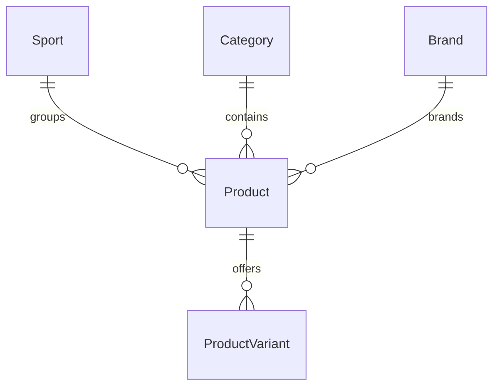

# Онлайн магазин за спортни стоки

## Документация за първи етап

Автор: Никола Александър Николов, 12Г клас

Училище: Частна професионална гимназия за дигитални науки „СофтУни БУДИТЕЛ“

Професия: Приложен програмист, код 481030

Специалност: Приложно програмиране, код 4810301

Ръководител консултант: Кирил Поповски

Дата: 6 ноември 2026 г.

Хранилище: https://github.com/nikonikolov1001/Final-Project

Код за етап 1: https://github.com/nikonikolov1001/Final-Project/tree/codex/etap-1-sports-store-20261106

Документация: https://github.com/nikonikolov1001/Final-Project/blob/codex/etap-1-sports-store-20261106/docs/Etap-1.md

## 1 Увод и концепция

При избора на спортни стоки клиентите сравняват предназначение, марка, цена, размер и наличност. Един продукт може да има различни размери и цветове, като всеки вариант разполага със собствено количество. Това изисква ясна организация на каталога и последователно съхраняване на данните.

Проектът предвижда онлайн магазин за спортни обувки, облекло и принадлежности с работно име SPORTLINE. Каталогът ще представя продуктите по спорт, категория и марка. В следващите етапи клиентите ще могат да използват профил, количка и поръчки, а служителите ще поддържат каталога и наличностите.

Първият етап уточнява посоката на проекта и създава техническа основа. Реализирани са начална страница, основен каталог и подробности за продукт, които използват данни от SQL Server. Примерните продукти и изображения са демонстрационни.

## 2 Цел задачи и очаквани резултати

Целта е да се разработи разбираемо и удобно уеб приложение за избор и поръчване на спортни стоки с управление на продукти, варианти и наличности.

Основните задачи за етап 1 са:

- проучване на поне три сходни магазина;
- определяне на обхвата и планираните функционалности;
- избор на технологии и организация на кода;
- проектиране и създаване на начална база с примерни данни;
- създаване на работеща начална структура и документация;
- осигуряване на достъп до кода и документацията.

Очакваният резултат от етапа е приложение, което се стартира и показва примерен каталог от реална база, придружено от увод, предварително проучване и план. Крайният резултат на дипломния проект ще включва и завършен процес за поръчване и служебно управление.

## 3 Предварително проучване

Разгледани са публични страници на Decathlon България, SPORT DEPOT и Sport Vision България на 6 ноември 2026 г. Проучването обхваща организацията на каталога, филтрите и представянето на вариантите. Не са създавани профили и не са извършвани покупки.

| Магазин | Наблюдавани възможности | Решение за проекта |
| --- | --- | --- |
| Decathlon | В разгледаната категория има филтри по цена, размер, марка и цвят [1] | Спортът и характеристиките да са организирани последователно |
| SPORT DEPOT | Каталогът предлага филтри по марка, размер, спорт и цвят [2] | Марка, спорт и категория да се пазят като отделни данни |
| Sport Vision | Продуктовата страница показва избор на размер и проверка на наличности [3] | Продуктът да има отделни варианти с размер, цвят и количество |

Предимство на разгледаните решения е възможността за стесняване на избора по конкретни характеристики. За малък учебен каталог голям брой филтри и връзки с физически магазини биха увеличили работата по данните и интерфейса. Затова началната версия използва прост списък с търсене, а допълнителните филтри се планират за по-късно.

Основният извод е да се отделят общите данни за продукта от данните за конкретния вариант. Публичните страници позволяват наблюдение на интерфейса, но не дават основание за оценка на вътрешната архитектура, сигурността или тестовете на тези магазини.

## 4 Технологии и начална база

Избрани са C# и ASP.NET Core MVC на .NET 10, Razor Views, Bootstrap, Entity Framework Core Code First и SQL Server. MVC организира страниците и заявките в едно приложение [4]. EF Core поддържа модела и промените по схемата чрез миграции [5]. Разработването се извършва с Visual Studio 2026.

Кодът е разделен на Controllers и Views за интерфейса, Services за подготовката на каталога, Entities за обектите и Data за контекста, миграциите и примерните записи. Потокът на една заявка е браузър, контролер, услуга, EF Core и SQL Server. След обработката Razor изгледът показва резултата.

| Обект | Данни и предназначение |
| --- | --- |
| Sport | Идентификатор и име на спорта |
| Category | Идентификатор и име на продуктовата категория |
| Brand | Идентификатор и име на марката |
| Product | Име, описание, цена, изображение и връзки към спорт, категория и марка |
| ProductVariant | Връзка към продукт, размер, цвят и налично количество |

Цените са decimal и трябва да са положителни. Наличностите не могат да са отрицателни. Комбинацията продукт, размер и цвят е уникална, а връзките са описани чрез външни ключове. Началната база SportlineStage1Basic се създава с миграция и съдържа 6 примерни продукта с 12 варианта, 3 категории, 3 марки и 3 спорта.

## 5 Състояние и план

Началната структура, каталогът и продуктовите подробности са реализирани. Проверките за този етап включват компилация, създаване на базата и разглеждане на страниците с реални данни. Инструкциите за подготовка и стартиране са в README на хранилището.

Планираните функции са профили с роли клиент, служител и администратор; разширени филтри; любими и отзиви; количка и поръчки с адрес, запазена цена и проверка на наличностите. Служебната част ще включва управление на продукти, варианти, поръчки и промоции, предупреждения и отчети. Те не се представят като готови функции на първия етап.

| Контролна дата | Планирана работа |
| --- | --- |
| 16 ноември 2026 | Концепция, проучване, увод, начално приложение и база |
| 18 декември 2026 | Профили, роли и управление на каталога |
| 12 февруари 2027 | Количка, поръчки и обработка на наличности |
| 26 март 2027 | Промоции, любими, отзиви, отчети и тестове |
| 19 април 2027 | Финални проверки, публикуване и окончателна документация |

При следващите етапи се проследяват и останалите изисквания на заданието: минимумите за компоненти, подходящ Design Pattern, валидация, персонализирани грешки, автоматични проверки и минимум 65 процента покритие на бизнес логиката с отчет. Кодът и документацията са публично достъпни за четене от консултанта чрез посочените линкове.

## 6 Източници

Прегледани на 6 ноември 2026 г. Графикът и изискванията са от предоставеното задание.

1. Decathlon България — мъжки обувки за бягане: https://www.decathlon.bg/11640-mazhki-obuvki-za-byagane
2. SPORT DEPOT — мъжки обувки: https://www.sportdepot.bg/muje-obuvki
3. Sport Vision — продуктова страница: https://www.sportvision.bg/maratonki/411704-adidas-response-runner-2
4. Microsoft Learn — ASP.NET Core MVC: https://learn.microsoft.com/en-us/aspnet/core/mvc/overview?view=aspnetcore-10.0
5. Microsoft Learn — EF Core migrations: https://learn.microsoft.com/en-us/ef/core/managing-schemas/migrations/
